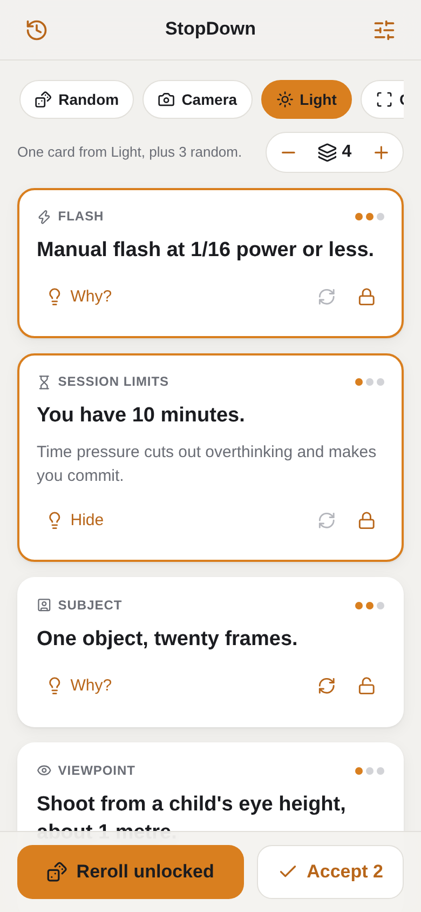
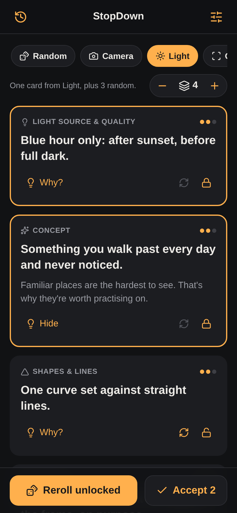
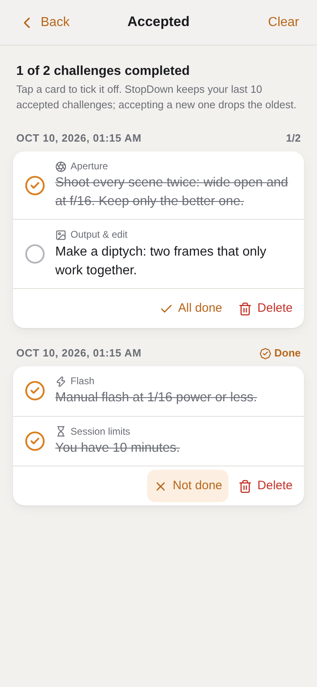
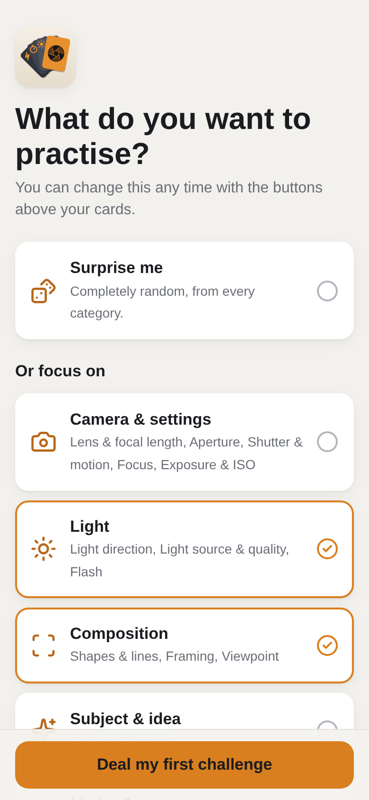
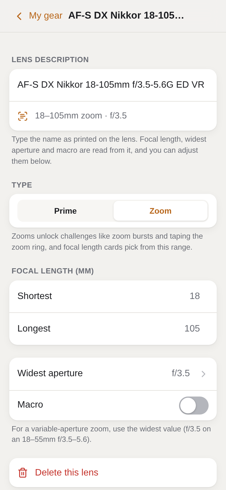
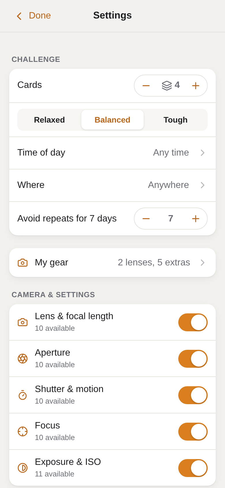
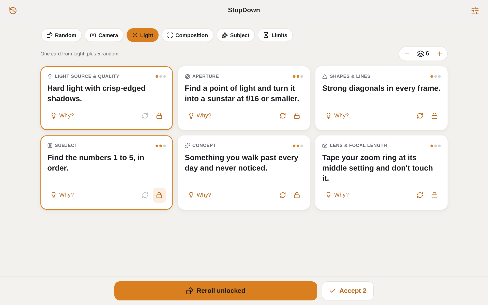

# StopDown

**Photo challenges that actually fit your camera bag.**

StopDown deals you a hand of creative constraints for your next shoot ("backlight only", "10 frames for the whole session", "shoot from ground level") based on the gear you actually own. Lock the cards you like, reroll the rest, accept the challenge and go shoot. Tick the cards off when you've nailed them.

It runs in the browser on your phone, tablet or computer, installs to your home screen, and works offline. No account, no ads, no tracking. Everything stays on your device.

<p align="center">
  
  &nbsp;
  
  &nbsp;
  
</p>

## Why I built it

I shoot on an old Nikon D90 and every so often I hit the wall where I go out, take the same photos I always take, and come home bored. Constraints are the best cure I know for that: one focal length, one colour, ten frames, no looking at the screen. The trouble is coming up with good ones on the spot, and half the "random photo prompt" lists online tell you to do things your gear can't do.

So I made something that knows what's in my bag. If you don't own a fast lens, you won't get "shoot at f/2". If you have no flash, there are no flash cards. And it won't pair cards that contradict each other, like "silhouettes only" with "flat front light".

## Features

- **317 constraints across 16 categories**, grouped into Camera & settings, Light, Composition, Subject & idea, and Limits & output.
- **Gear-aware.** Tell it your sensor size, lenses (including fisheye, tilt-shift/Lensbaby and old manual lenses) and extras, grouped into Camera, Support, Light, Filters, Lens add-ons and Props. It only deals cards you can actually do. Cards that ask for a focal length only use lengths you own.
- **Type your lens the way it's printed on it.** "AF-S Nikkor 35mm 1:1.8G" fills in the focal length and aperture by itself.
- **Random or focused.** Go fully random, or pick categories you want to practise. Each one you pick is guaranteed a card.
- **1 to 10 cards.** Lock the ones you like, reroll single cards or everything that isn't locked.
- **Difficulty, time of day and indoors/outdoors**, so you don't get blue hour cards at noon.
- **No repeats for a while.** Recently used cards are held back for as long as you choose.
- **Accepted challenges.** Accept saves only the locked cards. Your last 10 challenges are kept, and you can tick off each card once you've shot it.
- **Idea pool counter.** It shows how many different challenges your gear allows. With a basic kit lens and 3 cards that's over 1.2 million.
- **Backup.** Export and import your gear, settings and challenges as a file.
- **Works anywhere:** phone, tablet, desktop, light and dark mode, offline.

<p align="center">
  
  &nbsp;
  
  &nbsp;
  
</p>

## Try it

**Live version:** https://bitdaemon.github.io/StopDown/

To put it on your phone:

- **iPhone / iPad:** open the link in Safari, then Share → **Add to Home Screen**
- **Android:** open the link in Chrome, then menu → **Install app**

From then on it opens like a normal app and works without signal.

## How it works

Every constraint is a small bit of data: what it says, why it's worth doing, how hard it is, what gear it needs, and what it clashes with. When you deal a hand, StopDown:

1. filters out anything your gear, the time of day or the location rules out,
2. picks one card per category at most, skipping anything that contradicts a card already in the hand,
3. keeps the hand within the difficulty you chose,
4. leans away from cards you've had recently,
5. fills in the blanks ({colour}, {focal}, {minutes} and so on) with something you haven't had lately.

The whole thing is plain HTML, CSS and JavaScript. No framework, no build step, no server.

<p align="center">
  
</p>

## Run it yourself

Clone the repo and either:

- double-click `index.html` (everything works except installing and the offline cache), or
- serve the folder locally:
  ```sh
  python3 -m http.server 8000
  ```
  then open http://localhost:8000

### Host your own copy on GitHub Pages

Fork the repo, then go to **Settings → Pages**, choose **Deploy from a branch**, then `main` and `/ (root)`. A minute later it's live at `https://<your-username>.github.io/StopDown/`.

When you change anything, bump `VERSION` in `sw.js` (`stopdown-v1` → `stopdown-v2`) so installed copies pick up the update.

## Adding your own constraints

All the constraints live in [`data/constraints.js`](data/constraints.js). It's plain JSON between the `/*BEGIN-JSON*/` and `/*END-JSON*/` markers. It's wrapped in one line of JavaScript so the app also works when you open the file straight from disk.

A constraint looks like this:

```json
{
  "id": "ss.long",
  "axis": "shutter",
  "difficulty": 2,
  "text": "Tripod, 10 seconds or longer.",
  "why": "Long exposures smooth water and clouds and reveal light the eye can't gather.",
  "tags": ["slow-shutter", "long-exposure"],
  "excludes": ["fast-shutter", "freeze"],
  "requires": ["tripod"],
  "time": ["golden", "night"]
}
```

- **`tags` and `excludes`:** what the card asserts, and what can't appear on another card in the same hand.
- **`requires`:** gear it needs. Every item must be present.
  - lenses: zoom, prime, wide, tele, fast-lens, macro, fisheye, tilt-lens, manual-lens
  - camera: multi-exposure, remote, phone-camera, film-camera
  - support: tripod, monopod, clamp
  - light: flash, off-camera-flash, second-flash, led, softbox, snoot, reflector, gels
  - filters: nd, polariser, grad-nd, diffusion, star, ir
  - lens add-ons: extension-tubes (also counts as macro), teleconverter
  - props: prism, fairy-lights, spray, cellophane, backdrop
- **`time` and `place`:** optional limits (day / golden / night, indoor / outdoor).
- **`{focal}`:** filled from your lenses. Any other `{word}` comes from the matching list under `lists`.
- **`id`:** keep ids unique and don't reuse old ones, since people's history refers to them.

Then check your changes:

```sh
python3 tools/pool_report.py               # validates the library and counts the pool per gear profile
python3 tools/pool_report.py --sample 20   # prints 20 random challenges so you can read how they feel
node --test tests/core.test.js             # generator, gear, lens parsing, and the no-contradictions checks
```

Got an idea for a good constraint? Open an issue with the **Constraint idea** template. I'd love to hear it.

## Project layout

```
index.html              the page (with the icon sprite inline)
manifest.webmanifest    install info: name, icons, colours
sw.js                   service worker for offline use
css/app.css             all the styling, phone to desktop, light and dark
data/constraints.js     the constraint library
js/core.js              the generator, gear and lens parsing (no DOM, shared with the tests)
js/store.js             app state and saving to the browser
js/ui.js                the screens
js/app.js               start-up
icons/                  app icons
tools/                  pool_report.py and test gear profiles
tests/                  Node tests
docs/screenshots/       the pictures in this README
```

## A note on how this was built

This is a vibe-coded project. I designed what it should do (the gear-aware rules, the card categories, how locking and accepting should work) and I tested it on my own camera and phone, but most of the code was written with an AI assistant. It’s tested (there’s a Node test suite and a script that checks the constraint library), but it hasn’t had a professional code review. If you spot something off, please open an issue

## Privacy

There's nothing to sign up for and nothing is sent anywhere. Your gear, settings and challenges are stored in your browser on your device, and that's it.

Clearing your browser's website data wipes them, so use **Settings → Backup → Export** now and then. On iPhone, use StopDown from the Home Screen rather than a Safari tab, because Safari is stricter about keeping data for sites you haven't added.

## Licence

[MIT](LICENSE). Use it, change it, share it. Just keep my name and the licence with it.

Icons are from [Lucide](https://lucide.dev) (ISC licence, see `icons/LUCIDE-LICENSE.txt`).

Made by Richard Takacs.
